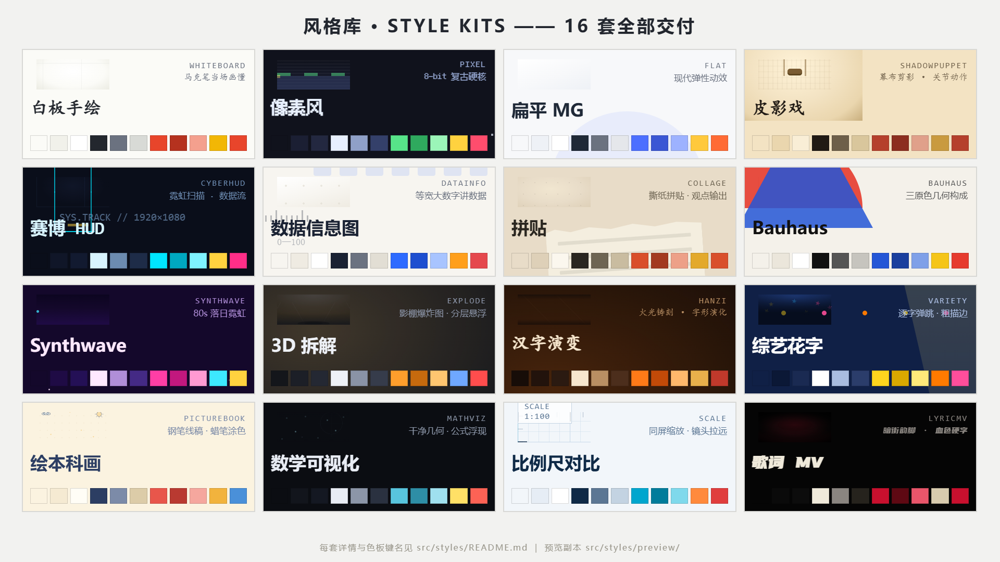
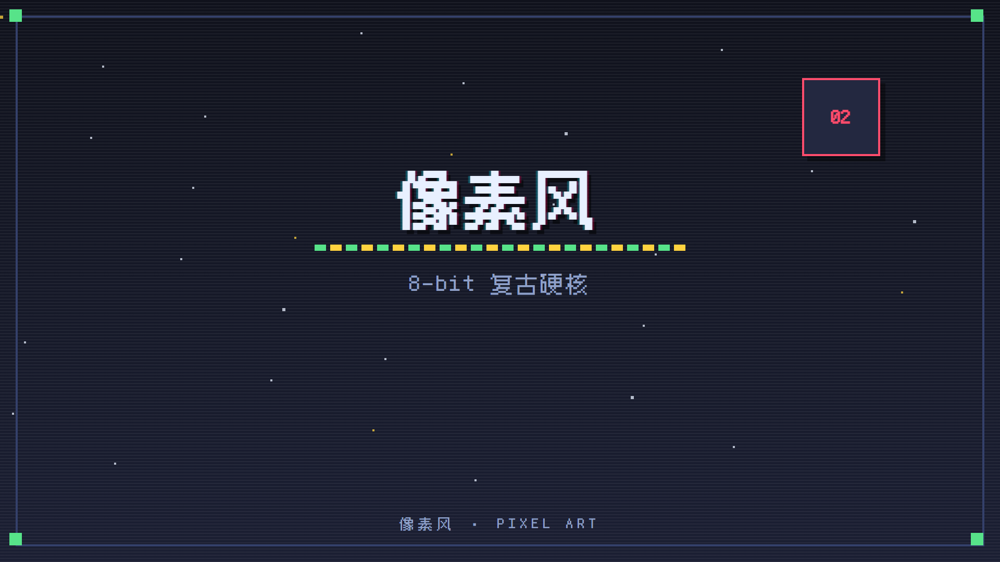
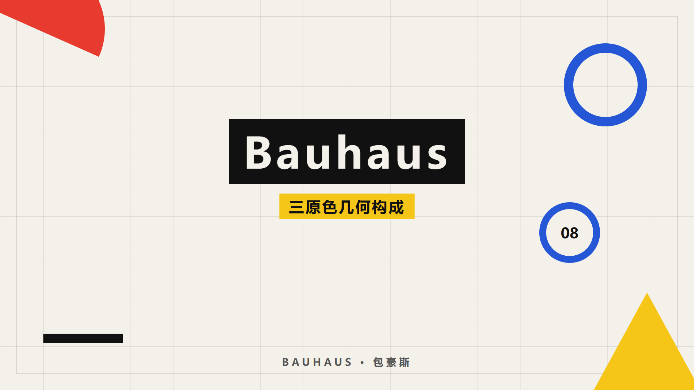
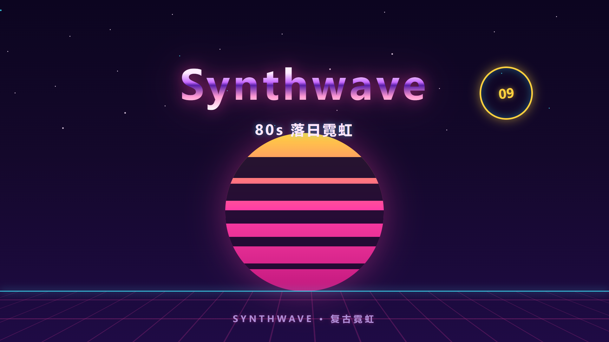
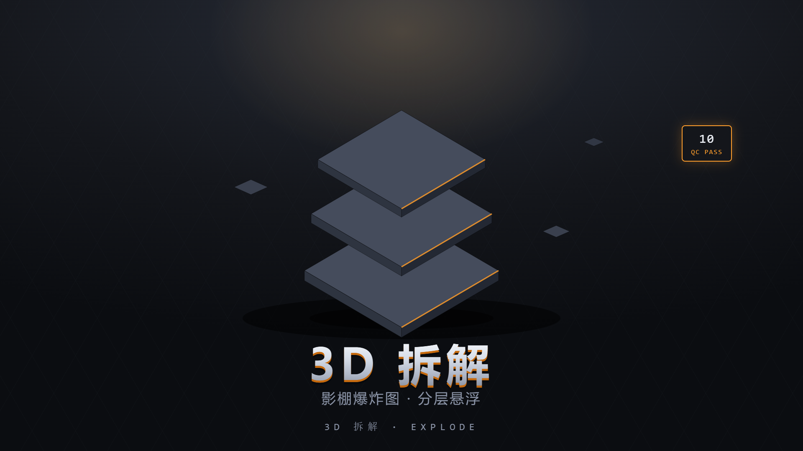
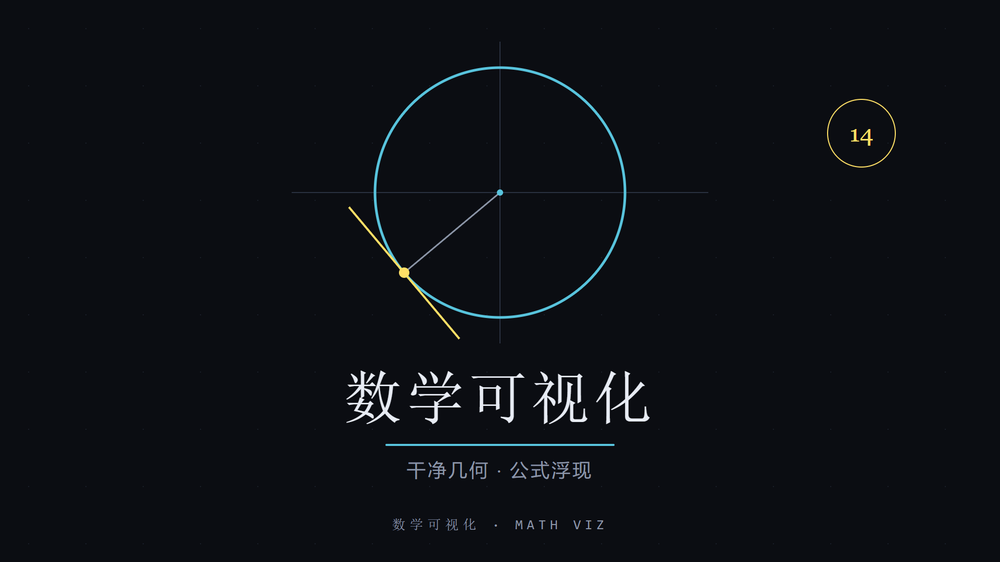
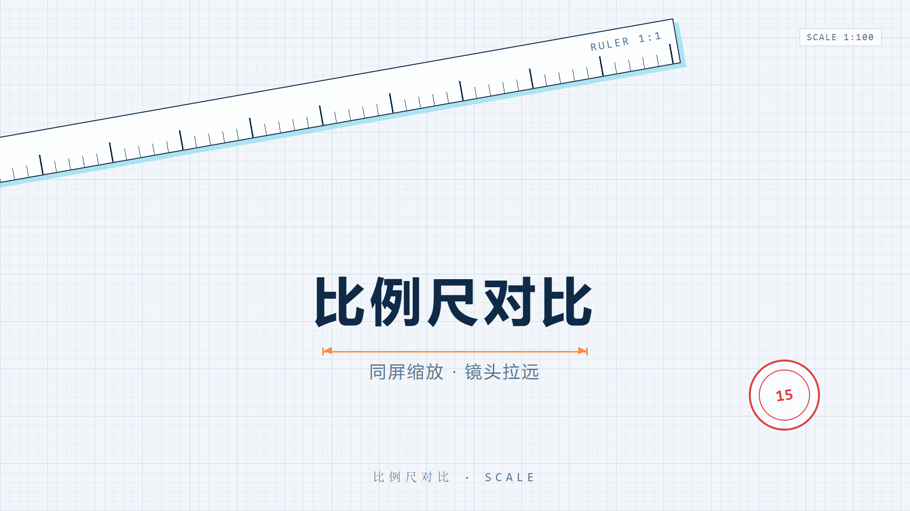
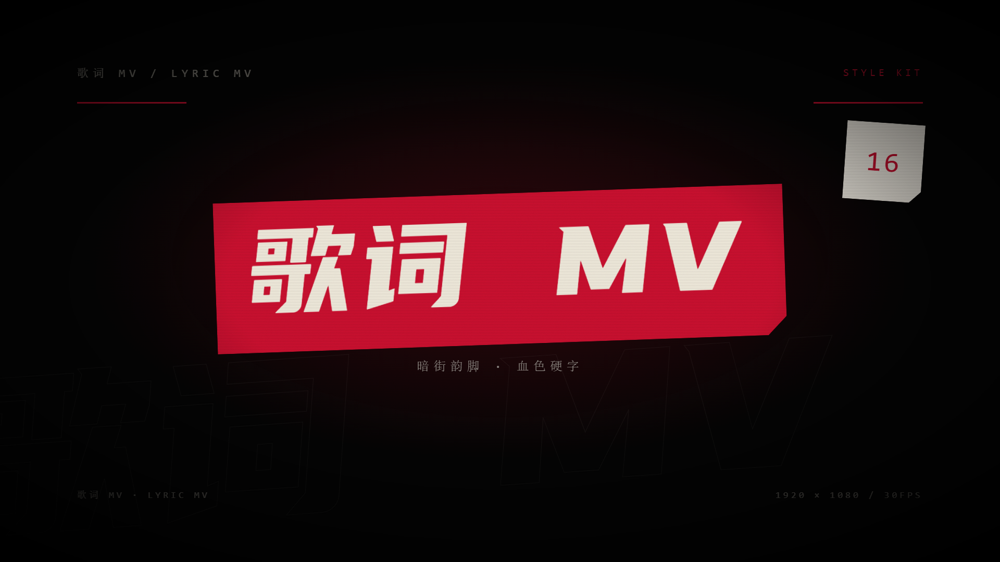

# 风格库视觉索引 · Style Preview

全部 **16 套**视频风格一览。媒体文件是 `out/styles/` 构建产物的仓库内预览副本（`out/` 不入库）；
每套风格的代码、色板与详细说明见 [`../README.md`](../README.md)。

## 总览（16 格）



## 逐套预览

### 01 · 白板手绘 `whiteboard`


马克笔当场画懂 ｜ 演示片：[demo-whiteboard.mp4](./demo-whiteboard.mp4)

### 02 · 像素风 `pixel`



8-bit 复古硬核 ｜ 演示片：[demo-pixel.mp4](./demo-pixel.mp4)

### 03 · 扁平 MG `flat`


现代弹性动效 ｜ 演示片：[demo-flat.mp4](./demo-flat.mp4)

### 04 · 皮影戏 `shadowpuppet`


幕布剪影 · 关节动作 ｜ 演示片：[demo-shadowpuppet.mp4](./demo-shadowpuppet.mp4)

### 05 · 赛博 HUD `cyberhud`


霓虹扫描 · 数据流 ｜ 演示片：[demo-cyberhud.mp4](./demo-cyberhud.mp4)

### 06 · 数据信息图 `datainfo`


等宽大数字讲数据 ｜ 演示片：[demo-datainfo.mp4](./demo-datainfo.mp4)

### 07 · 拼贴 `collage`


撕纸拼贴 · 观点输出 ｜ 演示片：[demo-collage.mp4](./demo-collage.mp4)

### 08 · Bauhaus `bauhaus`



三原色几何构成 ｜ 演示片：[demo-bauhaus.mp4](./demo-bauhaus.mp4)

### 09 · Synthwave `synthwave`



80s 落日霓虹 ｜ 演示片：[demo-synthwave.mp4](./demo-synthwave.mp4)

### 10 · 3D 拆解 `explode`



影棚爆炸图 · 分层悬浮 ｜ 演示片：[demo-explode.mp4](./demo-explode.mp4)

### 11 · 汉字演变 `hanzi`


火光铸刻 · 字形演化 ｜ 演示片：[demo-hanzi.mp4](./demo-hanzi.mp4)

### 12 · 综艺花字 `variety`


逐字弹跳 · 粗描边 ｜ 演示片：[demo-variety.mp4](./demo-variety.mp4)

### 13 · 绘本科画 `picturebook`


钢笔线稿 · 蜡笔涂色 ｜ 演示片：[demo-picturebook.mp4](./demo-picturebook.mp4)

### 14 · 数学可视化 `mathviz`



干净几何 · 公式浮现 ｜ 演示片：[demo-mathviz.mp4](./demo-mathviz.mp4)

### 15 · 比例尺对比 `scale`



同屏缩放 · 镜头拉远 ｜ 演示片：[demo-scale.mp4](./demo-scale.mp4)

### 16 · 歌词 MV `lyricmv`



暗街韵脚 · 血色硬字 ｜ 演示片：[demo-lyricmv.mp4](./demo-lyricmv.mp4)

---

## 如何再生成

封面（`StyleCover-<id>`，注册于 `src/Root.tsx`，文案来自 `src/styles/demo/catalog.ts`）：

```bash
for id in whiteboard pixel flat shadowpuppet cyberhud datainfo collage bauhaus synthwave \
          explode hanzi variety picturebook mathviz scale lyricmv; do
  npm run still -- "StyleCover-$id" "src/styles/preview/cover-$id.png"
done
```

演示片与总览图（先渲染到 `out/styles/`，再复制进本目录）：

```bash
for id in whiteboard pixel flat shadowpuppet cyberhud datainfo collage bauhaus synthwave \
          explode hanzi variety picturebook mathviz scale lyricmv; do
  npm run render -- "StyleDemo-$id" "out/styles/demo-$id.mp4"
done
npm run still -- StyleGallery out/styles/gallery.png
cp out/styles/demo-*.mp4 out/styles/gallery.png src/styles/preview/
```
